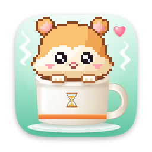
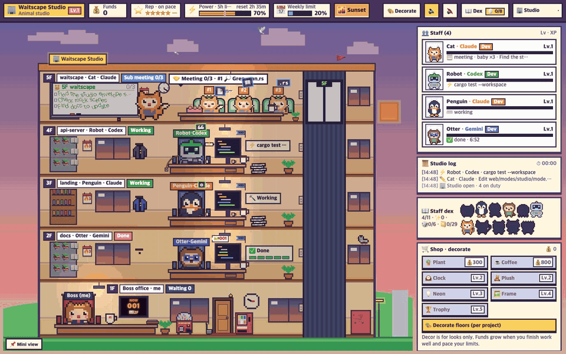
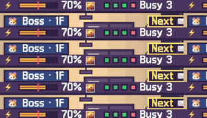
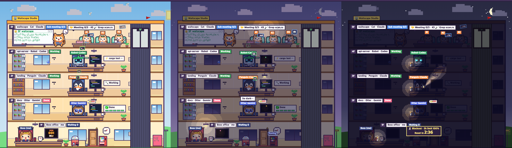
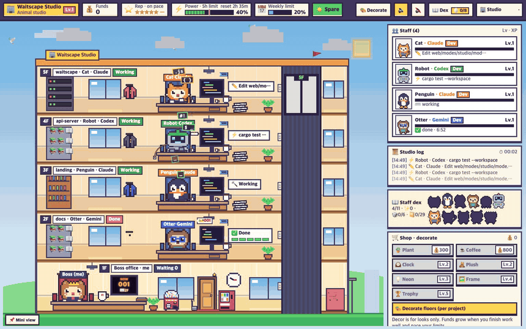
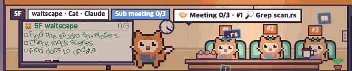
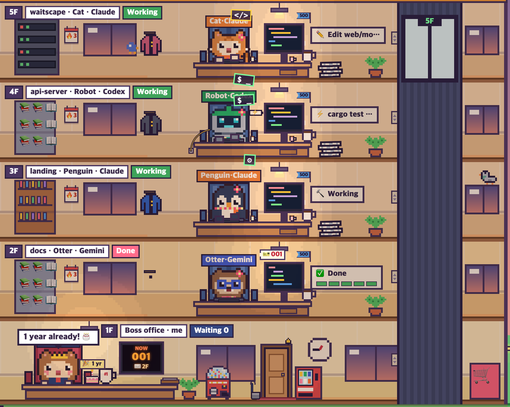

<div align="center">



# Waitscape

**Make the wait worth watching.**

[](https://github.com/jhkwim/waitscape/releases/latest)
[](docs/INSTALL.md)
[](docs/INSTALL.md)
[](https://tauri.app)
[](LICENSE)

[한국어](README.md) · **English**

</div>

Waitscape is a desktop app that turns your AI coding agent sessions (Claude Code, Codex and more) into a **pixel-art office**. Each session becomes a staff member working on their own floor. When one has a question, they ride the elevator down to the boss (you) on the first floor. When they finish, they come to report. You can see who is doing what, and who is waiting on you, without watching your terminals.

<div align="center">

<br><sub>All sessions and projects shown are fake demo data. Korean is built in too.</sub>
</div>

## Why

- **Waiting stops being boring.** When an agent works for 10 or 30 minutes, there's something to watch. Eleven kinds of animal staff (hamster, penguin, beaver, otter, octopus, robot, cat, fox, panda, plus a locked owl and hedgehog) type away with every tool call, and subagents gather in the meeting room.
- **Nothing slips by.** A question triggers an OS notification and the staff member walks to the boss's office. With the hook on, clicking that staff member or the done banner on screen jumps to that session's terminal (cmux or Orca).
- **Limits at a glance.** Your Claude 5-hour usage limit is the building's clock. The more you use, the later the day gets. Hit 100% and the power goes out.

## How it works

1. 🪝 **Turn on the hook on first launch.** The app backs up your Claude Code settings (`~/.claude/settings.json`) and adds only Waitscape's entries. It still works from session logs if you skip this.
2. 👀 **Keep working with your AI as usual.** The app reads session logs and hook events on your machine. No server to run.
3. 🏢 **Pick a view.** Studio is the default. Keep a small mini view on top of other windows, or switch to a plain work-tool look when someone walks by.

## Tour

<table>
<tr>
<td width="44%" align="center"></td>
<td width="56%" valign="middle">
<h3>📌 Mini view</h3>
A tiny always-on-top "lobby camera". The big window hides and only this small one stays above your other apps. It watches the boss's office, and when something happens it goes to that floor. Questions get a close-up and a caption; big wins get fireworks on the roof and a report to the boss. When subagents spin up, it follows the elevator to the meeting room. Scroll or press ↑↓ to look around the floors yourself. Chairs and tiny details like naps, desk props and the night guard show up in the mini view too.
</td>
</tr>
<tr>
<td colspan="2" valign="middle">
<h3>⚡ Limits = building power</h3>
Your 5-hour usage drives the building's day. From 50% the sun sets and lights come on floor by floor. From 80% it's power-saving: half the lights, vending machine off. At 100% there's a blackout: candles, flashlights, and a "resets in h:mm" sign. On reset the rooster crows and the sun rises. Outside, the weather follows the season and the date: clear, cloudy, rain, snow or fog (worked out from your computer's time zone, no internet needed). Turn on "Limit weather" in settings and your weekly usage takes over above 60% (clouds, rain, snow).
<p align="center"></p>
</td>
</tr>
<tr>
<td colspan="2" valign="middle">
<h3>🙈 Low-profile mode</h3>
Looks too much like a game at the office? Press <b>⌃Q</b> (Windows <b>Alt+`</b>), even while using another app. The blinds drop and you get "Agent Sessions", a plain work tool with a session table, progress, limit bars and recent activity. The window title and OS notifications turn plain too, with no sounds. Press again and the blinds go up, back to the studio. Set Settings → General → Low-profile mode → Transition to "With staff leaving & arriving" (Studio) and the staff head home before the blinds close; on the way back a cat peeks through the closed blinds, then everyone walks in with coffee (GIF below).
<p align="center"></p>
</td>
</tr>
<tr>
<td colspan="2" valign="middle">
<h3>🤝 Meeting room & result envelopes</h3>
When the AI hands work to subagents, that floor turns into a meeting room. Baby staff take the mint meeting chairs and their tasks go up on the whiteboard. A baby who finishes carries a ✉️ result envelope to the parent at the whiteboard ("📨 Oh, thanks!"), then heads back to rest with a donut. Once the last envelope is in, everyone cheers.
<p align="center"></p>
</td>
</tr>
<tr>
<td colspan="2" valign="middle">
<h3>🔍 Tiny details</h3>
Look closer at Studio and small things keep showing up. The boss sits in a red executive chair, the staff in blue office chairs, and the meeting-room babies in mint meeting chairs. Empty coffee cups pile up during long sessions, a jacket goes up on the wall hook, and papers stack up as the context fills. Hit 100, 500 and 1,000 tool calls and a flag pops up on the monitor; the robot plugs in a cable when its battery runs out. Staff waiting to ask a question start tapping their feet after a minute, and on Friday evenings everyone switches to Hawaiian shirts and a flower. Pigeons visit the window sills, a guard cat patrols at night, the boss's mug changes its slogan when you click it, and a cake appears on your install anniversary.
<p align="center"></p>
</td>
</tr>
</table>

Besides Studio there are 🐹 Hamster, 🏟️ Scoreboard, 🪐 Orbit, 💼 Work, 🌊 Flow and 📌 Pocket views (these still show Korean text). Switch with number keys, or <a href="MODES.md">build your own mode</a>.

## Using it

### 🙈 Low-profile mode

| Where | Toggle |
|---|---|
| Even in other apps | **⌃Q** (Windows **Alt+`**): change it in Settings → General, or turn it off with the switch |
| With the Waitscape window in front | **B** or **⌘1** (Windows **Ctrl+1**) |
| Menus | Menu bar (tray) · window right-click → 🙈 Low-profile mode |

- **Stays the same:** session data, done alerts, session jumps and funds. It stays on after you restart the app.
- **Changes:** the screen (a work tool), the window title and OS notification text (e.g. "api-server · Task finished · 13 min"), and no sounds. The mini view becomes a small list too.
- **The work-tool screen:** running, waiting and done-today counts with 5-hour and weekly limit bars at the top, then 📥 Up next, the session table and recent activity. Filter the table with the All, Running, Waiting and Done tabs; each row shows progress (context, todos) and badges such as approval, question or may-be-stuck. Rows with subagents expand. Alongside the done-today count you get work time, the longest task and the average input wait.
- **Jump to a session:** sessions opened in cmux or Orca get a **Go to cmux** (or **Go to Orca**) button at the end of the row that takes you to that terminal. The mini-view list has a **↗ cmux** button.
- **Settings → General → 🙈 Low-profile mode:** brightness (System, Light, Dark) and the transition (short blinds by default; pick "With staff leaving & arriving" and in Studio the staff take their bags down the elevator, then come back with coffee).
- Press again mid-transition to finish it right away. With reduce motion or meeting mode it switches instantly.

### 📌 Mini view

| To do this | Use |
|---|---|
| Go mini | Studio's **📌 Mini view** button · **⌘2** (Windows **Ctrl+2**) · menu bar (tray) · window right-click |
| Back to the big window | **⤢** (shows on hover) · **⌘2** (Windows **Ctrl+2**) · right-click menu · Dock icon (macOS) · menu bar (tray) "Full Window" |
| Look around the floors | Wheel or trackpad (one floor at a time) · ▲▼ (on hover) · **↑↓** keys · status dots at the top · the "Next" chip |
| Go to the next session | **N** (skip with **Shift+N**) — see 📥 Up next below |
| Back to the auto camera | **Esc**, or leave it alone for 10 seconds |

- You see either the big window or the mini view, never both. If you quit in the mini view, the next launch starts there too.
- The "Next" chip uses the same order as 📥 Up next (🔑 permission → ❓ question → 💤 stall → ✉️ unseen done). Click it to go to that floor; it counts as seen.
- The **🎥Cut / 🎥Pan** button (on hover) picks how the camera moves between floors (cut = quick jump, pan = glide up and down).
- Click a floor's name tag chip to jump straight to that session's terminal (app).
- In 📌 Pocket mode, the pin button that floats it on top is the mini view (app; a PiP window in the browser). The widget expands by itself when input is needed.

### 📥 Up next

With several sessions open, Waitscape lines up the sessions that need your hands right now: 🔑 permission → ❓ question → 💤 stalled? → ✉️ done but not seen yet. Within each kind, the one that has waited longest comes first.

| To do this | Use |
|---|---|
| Go to the first session | **N** in a Waitscape window — sessions opened in cmux or Orca jump straight to that terminal. For others it tells you which session it is |
| While using another app | **⌃⇧N** (Windows **Alt+Shift+N**) — works even when the window is hidden. Sessions it can't jump to show up as an OS notification. Change or turn it off in Settings → General → 📥 Up next |
| Skip | **Shift+N** — it comes back with a new question or the next time it finishes. A permission or question you can't jump to stays first until you answer or skip it |
| See the list | "Up next" at the top of 🙈 Low-profile mode and 💼 Work mode, and the "Next" chip in Studio's mini view |
| In Studio's big window | 🎫 The boss's monitor turns into a ticket board ("NOW 001 · 🔑5F +3") and the staff member gets a ticket over their head. ✉️ Unseen done work piles up as envelopes in the 📥 inbox tray on the boss's desk (thicker for long jobs). Check it and a red approval stamp lands |

- Guesses (like a permission request that might be approved right away) are left out.
- A question alert for the same session rings at most once every 10 minutes (the question itself still shows).
- Questions that wait long get an orange speech-bubble border after 5 minutes and red after 15. The top chip shows the longest wait, like "❓2 · longest 14m".
- 🧪 Finished work carries that turn's test result: ✓ passed / ✗ failed (from the last run's output and exit code), just 🧪 if a pipe like `| tail` hid the result, nothing if no tests ran. Shown in Up next, Studio's done sign, the inbox tray (red dot = failed) and the done notification (Claude Code only).
- A 💤 stalled staff member doesn't nap: they sit with eyes open, tapping a frozen monitor (so you can tell them apart from resting staff).

## And more

- **Jump to the session**: click a staff member with a question, a done banner or a floor tag to open that cmux pane or Orca terminal. Otherwise it opens a terminal (or editor) in the session folder. Jumping needs the hook turned on.
- **👆 Click reactions**: staff and props (monitors, coffee, plants, vending machine, elevator…) react when clicked. There are 8 hidden easter eggs.
- **📋 Daily report**: when everything has been quiet for about 45 minutes in the afternoon, the boss waves a sheet: "The report is in!" It announces today's finished work, hours and MVP, then makes a shareable card (PNG).
- **⚡ Quick replies**: answer a staff question within a minute and they cheer "👍 Quick!" with bonus funds. Keep answering fast for a 🔗 combo.
- **🎨 Decorate floors**: spend the funds you earn from finished work on props for each project's floor. Each animal has favorites. No real payments.
- **🍩 Snacks & 🍖 team dinner**: pick a floor on the 🎨 decorate panel to buy its staff ☕ coffee, 🍩 a donut, 🍕 pizza or 🍰 cake (two per staff a day). The snack sits on the desk and gets eaten a few bites at a time. In the evening the 📋 daily report lets everyone go up for a rooftop barbecue, and the next day a dinner photo hangs on 1F.
- **🎰 Capsule machine**: drop funds into the machine on 1F, turn the handle, and a capsule rolls out and pops open: staff accessories (hats, sunglasses…), desk toys, or a "job application" that unlocks a locked animal. Everything goes into a collection on the decorate panel, and duplicates refund part of the cost.
- **📔 Sightings**: the first time you spot a tiny detail, it gets stamped and you earn 💰+5. The 📖 dex shows the 29 scenes you've seen and hints for the rest.
- **😴 Naps & 🍱 lunch**: staff who've been idle a while start nodding off, then sleep on the desk, and jump awake ❗ when work comes back. At noon, idle staff eat a bento, ramen, onigiri or sandwich at their desks, then doze off after lunch.
- **🎲 Random events**: every now and then someone drops by unannounced: a 🍕 pizza courier, a 📦 mystery box, a 🐈 lost kitten, a 🖨️ jammed printer, a 🎈 balloon, or (rarely, at night) a 🌠 shooting star. Click them for a small bonus in funds (up to 5 a day).
- **Subagent meetings**: subagents show up as baby animals in the meeting room, writing tasks on the whiteboard and checking them off. A baby that finishes carries a result envelope over to its parent.
- **✍️ AI-written boards**: turn on Settings → AI tools → MCP reports and the AI writes its plan on that floor's whiteboard, ticking off lines as it goes. The board is wiped a little after the work ends.
- **🔕 Meeting mode**: no sound, no flashing. It also follows your OS "reduce motion" setting.
- **In-app updates**: you get a notice when a new version is out. It downloads only when you click, and verifies the signature before installing.
- **Korean and English**: follows your OS language, changeable in Settings.

## Supported tools

| Tool | Sessions | How to connect | Usage limits |
|---|---|---|---|
| **Claude Code** | ✅ | Hook (recommended) or automatic session-log reading | ✅ 5-hour · weekly (opt-in) |
| **Codex CLI** | ✅ (experimental) | Settings → AI tools → MCP reports | — |
| **Antigravity CLI** | ✅ (experimental) | Settings → AI tools → MCP reports | — |

Jump-to-terminal works for sessions opened in **cmux** (macOS) and **Orca** (macOS and Windows). cmux needs no settings change; macOS asks once to let Waitscape control cmux. Antigravity sessions show up as Gemini.

## Install

### Requirements

- macOS 13 or later (universal: Apple silicon and Intel)
- Windows 10 1809 or later (x64)

### Download

Get the `.dmg` (macOS) or the `.exe` / `.msi` (Windows) from the [latest release](https://github.com/jhkwim/waitscape/releases/latest).

- **macOS:** from 0.4.2 the app is notarized by Apple; macOS only asks once to confirm opening an app downloaded from the internet (click **Open**). On 0.4.1 and earlier, if you see "Not Opened", click **Done** (don't move it to the Trash), then go to **System Settings → Privacy & Security → Open Anyway**.
- **Windows:** not code-signed yet, so SmartScreen may warn once. Click **More info → Run anyway**.

Checksums and uninstall steps are in the [install guide](docs/INSTALL.md).

### Build from source

You need Rust 1.90+ and Tauri CLI 2.

```bash
cargo install tauri-cli --version "^2" --locked
cd app/src-tauri
cargo tauri dev      # run in development
cargo tauri build    # build installers
```

For the browser version (`python3 server.py`), tests and the API, see the [development guide](docs/DEVELOPMENT.md) (Korean).

## Privacy

- **Everything is read locally.** Session logs and hook events come from local files and never leave your machine. Prompts and tool descriptions are scrubbed of tokens and passwords before they're shown.
- **The app talks to only two places:**
  - `api.anthropic.com`: Claude usage limits. Off by default; you have to opt in. It sends your Claude Code login token as a header, and the token stays in memory only.
  - `github.com/jhkwim/waitscape` releases: update checks (`latest.json`). The installer is downloaded from the same place only when you click [Update now]. You can turn checks off in Settings.
  - On Windows, if WebView2 is missing, the installer downloads it from Microsoft.
- **Config changes are shown to you.** Turning on the hook copies the `wr-hook` binary to `~/.claude/waiting-room/bin/`, backs up `~/.claude/settings.json` and adds only Waitscape's entries ("Show details" shows the change). MCP setup previews and backs up before applying, and disconnecting removes only what was added.
- **Diagnostic logs** never contain tokens or prompt text, and home paths are shortened to `~`.

## Project layout

| Folder | What's inside |
|---|---|
| `app/src-tauri/` | Desktop app (Tauri 2) |
| `crates/` | Rust core (`wr-core`), hook and report CLI (`wr-hook`), browser server (`wr-server`) |
| `web/` | UI: shared core and mode packages (no build step) |
| `types/` | Official types for `/state`, `/trace` and the mode API |
| `fixtures/`, `scripts/` | Test data and checks |
| `docs/` | [Install](docs/INSTALL.md), [release](docs/RELEASE.md), [development](docs/DEVELOPMENT.md), [roadmap PRD](docs/PRD.md) (Korean) |

File-by-file notes are in the [development guide](docs/DEVELOPMENT.md#구조); the design is in [ARCHITECTURE.md](ARCHITECTURE.md).

## Contributing

Bug reports, ideas and new modes are all welcome. Start with [CONTRIBUTING.md](CONTRIBUTING.md).

- Building modes: [MODES.md](MODES.md)
- Security reports: [SECURITY.md](SECURITY.md)
- Code of conduct: [CODE_OF_CONDUCT.md](CODE_OF_CONDUCT.md)

## License

[MIT](LICENSE). The pixel font **Galmuri11** is under the [SIL Open Font License 1.1](web/fonts/OFL.txt).

Waitscape is an unofficial personal project. It is not affiliated with or endorsed by Anthropic, OpenAI or Google. Claude, Codex and Antigravity are trademarks of their respective owners.

<sub>Built with [Claude Code](https://claude.com/claude-code).</sub>
