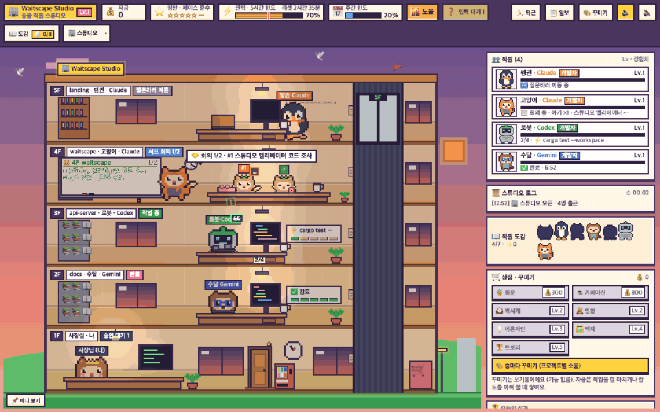
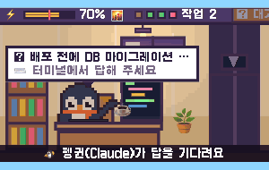
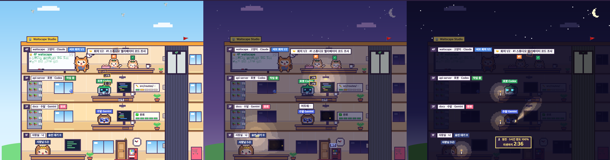
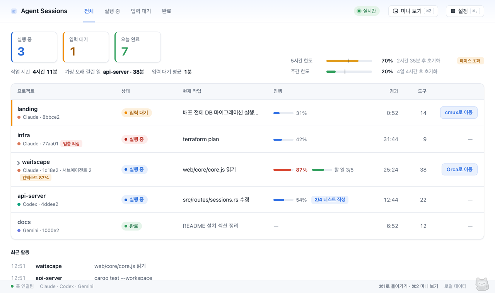
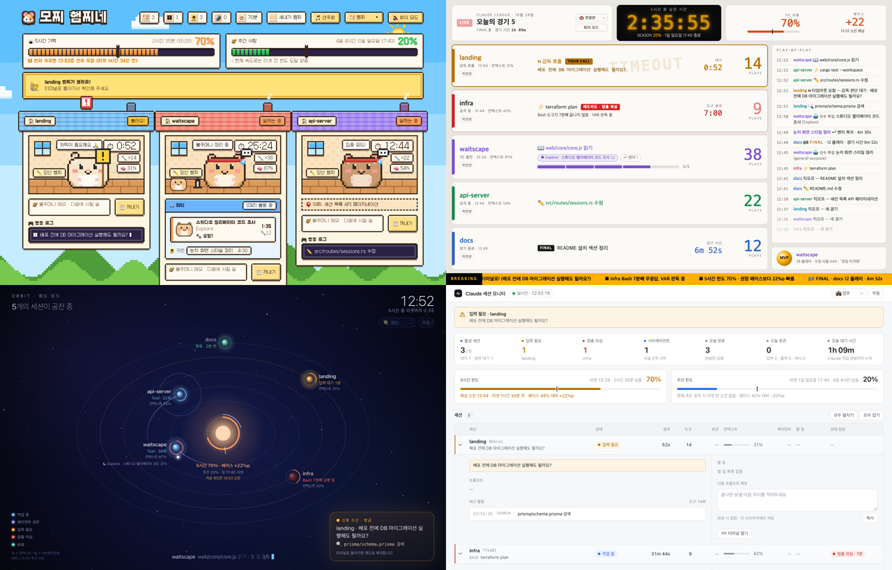

<div align="center">


# Waitscape

**Make the wait worth watching.**

[](https://github.com/jhkwim/waitscape/releases/latest)
[](docs/INSTALL.md)
[](docs/INSTALL.md)
[](https://tauri.app)
[](LICENSE)

[한국어](README.md) · **English**

</div>

Waitscape is a desktop app that turns your AI coding agent sessions (Claude Code, Codex and more) into a **pixel-art office**. Each session becomes a staff member working on their own floor. When one has a question, they ride the elevator down to the boss (you) on the first floor. When they finish, they come to report. You can see who is doing what, and who is waiting on you, without watching your terminals.

<div align="center">

<br><sub>All sessions and projects shown are fake demo data. The UI in these captures is in Korean; English is built in.</sub>
</div>

## Why

- **Waiting stops being boring.** When an agent works for 10 or 30 minutes, there's something to watch. Seven kinds of animal staff type away with every tool call, and subagents gather in the meeting room.
- **Nothing slips by.** A question triggers an OS notification and the staff member walks to the boss's office. With the hook on, one click jumps to that session's terminal (cmux or Orca).
- **Limits at a glance.** Your Claude 5-hour usage limit is the building's clock. The more you use, the later the day gets. Hit 100% and the power goes out.

## How it works

1. 🪝 **Turn on the hook on first launch.** The app backs up your Claude Code settings (`~/.claude/settings.json`) and adds only Waitscape's entries. It still works from session logs if you skip this.
2. 👀 **Keep working with your AI as usual.** The app reads session logs and hook events on your machine. No server to run.
3. 🏢 **Pick a view.** Studio is the default. Keep a small mini view on top of other windows, or switch to a plain work-tool look when someone walks by.

## Tour

<table>
<tr>
<td width="44%" align="center"></td>
<td width="56%" valign="middle">
<h3>📌 Mini view</h3>
A tiny always-on-top "lobby camera". It watches the boss's office, and when something happens it flies to that floor. Questions get a close-up and a caption; big wins get fireworks on the roof and a report to the boss. Scroll or press ↑↓ to look around the floors yourself.
</td>
</tr>
<tr>
<td colspan="2" valign="middle">
<h3>⚡ Limits = building power</h3>
Your 5-hour usage drives the building's day. From 50% the sun sets and lights come on floor by floor. From 80% it's power-saving: half the lights, vending machine off. At 100% there's a blackout: candles, flashlights, and a "resets in h:mm" sign. On reset the rooster crows and the sun rises. Weekly usage can show up as weather (clouds, rain, snow).
<p align="center"></p>
</td>
</tr>
<tr>
<td width="56%" valign="middle">
<h3>🙈 Low-profile mode</h3>
Looks too much like a game at the office? Press <b>⌃Q</b> (Windows <b>Alt+`</b>), even while using another app. The blinds drop and you get "Agent Sessions", a plain work tool with a session table, progress and limit bars. Notifications turn plain too. Press again and the staff walk back in with coffee.
</td>
<td width="44%" align="center"></td>
</tr>
<tr>
<td width="44%" align="center"></td>
<td width="56%" valign="middle">
<h3>🎨 More views</h3>
Besides Studio there's 🐹 Hamster (one hamster per session), 🏟️ Scoreboard (sports broadcast), 🪐 Orbit (a limit sun with session planets), 💼 Work (an observability dashboard), 🌊 Flow (the AI's train of thought) and 📌 Pocket (a small widget). Switch with number keys, or <a href="MODES.md">build your own mode</a>.
</td>
</tr>
</table>

## And more

- **Jump to the session**: click a staff member with a question, a done banner or a floor tag to open that cmux pane or Orca terminal. Otherwise it opens a terminal (or editor) in the session folder. Jumping needs the hook turned on.
- **👆 Click reactions**: staff and props (monitors, coffee, plants, vending machine, elevator…) react when clicked. There are 8 hidden easter eggs.
- **📋 Daily report**: when everything has been quiet for about 45 minutes in the afternoon, the boss waves a sheet: "The report is in!" It announces today's finished work, hours and MVP, then makes a shareable card (PNG).
- **🎨 Decorate floors**: spend the funds you earn from finished work on props for each project's floor. Each animal has favorites. No real payments.
- **Subagent meetings**: subagents show up as baby animals in the meeting room, writing tasks on the whiteboard and checking them off.
- **🔕 Meeting mode**: no sound, no flashing. It also follows your OS "reduce motion" setting.
- **In-app updates**: you get a notice when a new version is out. It downloads only when you click, and verifies the signature before installing.
- **Korean and English**: follows your OS language, changeable in Settings.

## Supported tools

| Tool | Sessions | How to connect | Usage limits |
|---|---|---|---|
| **Claude Code** | ✅ | Hook (recommended) or automatic session-log reading | ✅ 5-hour · weekly (opt-in) |
| **Codex CLI** | ✅ (experimental) | Settings → AI tools → MCP reports | — |
| **Antigravity CLI** | ✅ (experimental) | Settings → AI tools → MCP reports | — |

Jump-to-terminal works for sessions opened in **cmux** (macOS) and **Orca** (macOS and Windows). Antigravity sessions show up as Gemini.

## Install

### Requirements

- macOS 13 or later (universal: Apple silicon and Intel)
- Windows 10 1809 or later (x64)

### Download

Get the `.dmg` (macOS) or the `.exe` / `.msi` (Windows) from the [latest release](https://github.com/jhkwim/waitscape/releases/latest).

- **macOS:** from 0.4.2 the app is notarized by Apple; macOS only asks once to confirm opening an app downloaded from the internet (click **Open**). On 0.4.1 and earlier, if you see "Not Opened", click **Done** (don't move it to the Trash), then go to **System Settings → Privacy & Security → Open Anyway**.
- **Windows:** not code-signed yet, so SmartScreen may warn once. Click **More info → Run anyway**.

Checksums and uninstall steps are in the [install guide](docs/INSTALL.md).

### Build from source

You need Rust 1.90+ and Tauri CLI 2.

```bash
cargo install tauri-cli --version "^2" --locked
cd app/src-tauri
cargo tauri dev      # run in development
cargo tauri build    # build installers
```

For the browser version (`python3 server.py`), tests and the API, see the [development guide](docs/DEVELOPMENT.md) (Korean).

## Privacy

- **Everything is read locally.** Session logs and hook events come from local files and never leave your machine. Prompts and tool descriptions are scrubbed of tokens and passwords before they're shown.
- **The app talks to only two places:**
  - `api.anthropic.com`: Claude usage limits. Off by default; you have to opt in. It sends your Claude Code login token as a header, and the token stays in memory only.
  - `github.com/jhkwim/waitscape` releases: update checks (`latest.json`). The installer is downloaded from the same place only when you click [Update now]. You can turn checks off in Settings.
  - On Windows, if WebView2 is missing, the installer downloads it from Microsoft.
- **Config changes are shown to you.** Turning on the hook copies the `wr-hook` binary to `~/.claude/waiting-room/bin/`, backs up `~/.claude/settings.json` and adds only Waitscape's entries ("Show details" shows the change). MCP setup previews and backs up before applying, and disconnecting removes only what was added.
- **Diagnostic logs** never contain tokens or prompt text, and home paths are shortened to `~`.

## Project layout

| Folder | What's inside |
|---|---|
| `app/src-tauri/` | Desktop app (Tauri 2) |
| `crates/` | Rust core (`wr-core`), hook (`wr-hook`), browser server (`wr-server`) |
| `web/` | UI: shared core and mode packages (no build step) |
| `types/` | Official types for `/state`, `/trace` and the mode API |
| `fixtures/`, `scripts/` | Test data and checks |
| `docs/` | [Install](docs/INSTALL.md), [release](docs/RELEASE.md), [development](docs/DEVELOPMENT.md) |

File-by-file notes are in the [development guide](docs/DEVELOPMENT.md#구조); the design is in [ARCHITECTURE.md](ARCHITECTURE.md).

## Contributing

Bug reports, ideas and new modes are all welcome. Start with [CONTRIBUTING.md](CONTRIBUTING.md).

- Building modes: [MODES.md](MODES.md)
- Security reports: [SECURITY.md](SECURITY.md)
- Code of conduct: [CODE_OF_CONDUCT.md](CODE_OF_CONDUCT.md)

## License

[MIT](LICENSE). The pixel font **Galmuri11** is under the [SIL Open Font License 1.1](web/fonts/OFL.txt).

Waitscape is an unofficial personal project. It is not affiliated with or endorsed by Anthropic, OpenAI or Google. Claude, Codex and Antigravity are trademarks of their respective owners.

<sub>Built with [Claude Code](https://claude.com/claude-code).</sub>
